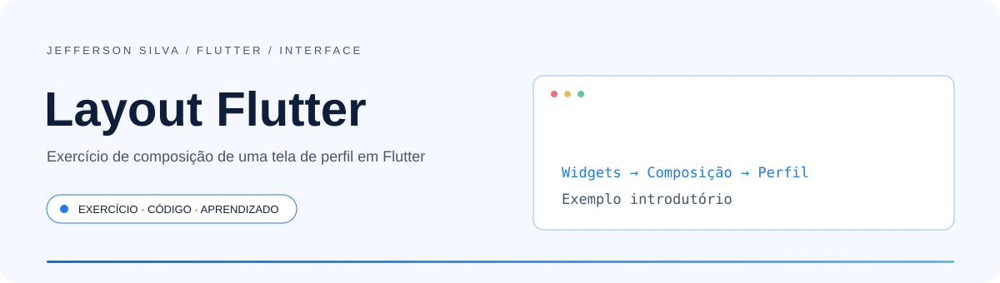
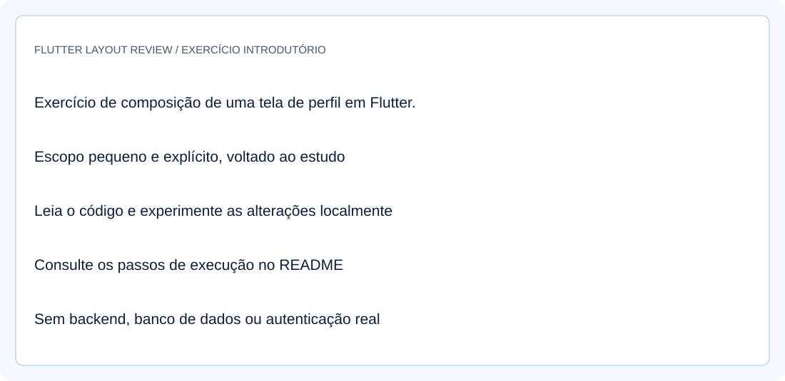
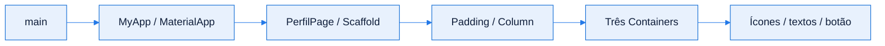

<!-- Jefferson Silva / README 4.0 — adaptado ao código de Flutter Layout Review. -->

<div align="center">

<picture>
  <source media="(prefers-color-scheme: dark)" srcset="./assets/banner-dark.svg" />
  <source media="(prefers-color-scheme: light)" srcset="./assets/banner-light.svg" />
  
</picture>

<br />
<br />

**Exercício de composição de uma tela de perfil em Flutter.**

<p>
  <a href="#inicio-rapido"></a>
  <a href="https://github.com/jeffsilva03/layout-UI---flutter-review/issues/new"></a>
</p>

[](https://github.com/jeffsilva03/layout-UI---flutter-review/commits/)
[](https://github.com/jeffsilva03/layout-UI---flutter-review)
[](https://github.com/jeffsilva03/layout-UI---flutter-review)
[](https://github.com/jeffsilva03/layout-UI---flutter-review/issues)
[](https://github.com/jeffsilva03/layout-UI---flutter-review/stargazers)

<a href="#stack">
  <picture>
    <source media="(prefers-color-scheme: dark)" srcset="https://skillicons.dev/icons?i=flutter,dart&theme=dark" />
    
  </picture>
</a>

<br />
<br />

<a href="#visao-geral">Visão geral</a> &nbsp;•&nbsp;
<a href="#demonstracao">Demonstração</a> &nbsp;•&nbsp;
<a href="#funcionalidades">Funcionalidades</a> &nbsp;•&nbsp;
<a href="#stack">Stack</a> &nbsp;•&nbsp;
<a href="#arquitetura">Arquitetura</a> &nbsp;•&nbsp;
<a href="#inicio-rapido">Instalação</a> &nbsp;•&nbsp;
<a href="#exemplos">Exemplos</a> &nbsp;•&nbsp;
<a href="#roadmap">Roadmap</a> &nbsp;•&nbsp;
<a href="#contribuir">Contribuir</a>

</div>

<br />

> [!NOTE]
> **Status:** Trecho de estudo de interface Flutter; um main.dart, sem projeto completo ou autenticação.

<a id="visao-geral"></a>
## ✦ Visão geral

**Flutter Layout Review** contém um único `main.dart` com uma tela de perfil construída com widgets Material. É um trecho de exercício de interface, sem `pubspec.yaml` ou projeto Flutter completo no repositório.

<table>
<tr>
<td width="33%" valign="top">

**🧩 Problema**

Praticar composição, alinhamento, espaçamento e decoração em Flutter.

</td>
<td width="33%" valign="top">

**🛠️ Solução**

Organiza três blocos de perfil com ícones, textos e um botão.

</td>
<td width="33%" valign="top">

**📈 Resultado**

Exemplo de interface estática para estudar widgets e adaptar dentro de um projeto Flutter.

</td>
</tr>
</table>

<a id="demonstracao"></a>
## ◐ Demonstração

<div align="center">

<picture>
  <source media="(prefers-color-scheme: dark)" srcset="./assets/screenshot-dark.svg" />
  
</picture>

<sub>Ilustração do escopo do exercício, não uma captura de execução.</sub>

</div>

<details>
<summary><b>▶ Ver o fluxo em ação</b></summary>

Siga o [Início rápido](#inicio-rapido) e os [Exemplos de uso](#exemplos). As ilustrações não são capturas de contas ou bancos pessoais.

</details>

<a id="funcionalidades"></a>
## ◈ Funcionalidades

<sub>✅ Implementado &nbsp; 🚧 Parcial &nbsp; 🗓️ Planejado</sub>

| Módulo | O que faz | Estado |
| :-- | :-- | :-- |
| **Estrutura Material** | MaterialApp, Scaffold e AppBar com título Perfil | ✅ |
| **Blocos de perfil** | Containers com textos, ícones, padding e espaçamento | ✅ |
| **Estilização** | Fundo cinza, cartões brancos, bordas e sombras | ✅ |
| **Botão Continuar** | Exibe uma mensagem no console; não navega ou salva dados | ✅ |
| **Projeto executável** | É necessário criar um projeto Flutter e inserir o arquivo | 🚧 |

<details>
<summary><b>▶ Regras de negócio e validações</b></summary>

Não há regras de negócio, persistência ou autenticação. Os textos são fixos. O botão chama `print("Clicou")`; não há validação de formulário, interação com API ou mudança de estado.

</details>

<a id="stack"></a>
## ⚙ Stack e decisões técnicas

| Camada | Tecnologia | Papel |
| :-- | :-- | :-- |
| Linguagem | Dart | Define a árvore de widgets |
| Interface | Flutter / Material | Componentes e composição visual |
| Estado | StatelessWidget | Tela estática sem estado mutável próprio |

<a id="arquitetura"></a>
## ⬡ Arquitetura



<details>
<summary><b>▶ Responsabilidade de cada componente</b></summary>

`MyApp` configura o MaterialApp e abre `PerfilPage`. A tela usa Column, Container, Padding, SizedBox, Icon, Text e ElevatedButton.

</details>

<details>
<summary><b>▶ Fluxo principal passo a passo</b></summary>

O `main()` executa MyApp, que abre PerfilPage. A tela monta os três cartões; tocar em Continuar apenas escreve no console.

</details>

<details>
<summary><b>▶ Modelo de dados</b></summary>

Não há entidades persistidas ou banco de dados. Nome e demais rótulos são literais no código, sem carregamento dinâmico.

</details>

<a id="inicio-rapido"></a>
## ⚡ Início rápido

**Pré-requisitos**

| Ferramenta | Uso | Como verificar |
| :-- | :-- | :-- |
| Flutter SDK | Criar e executar o projeto hospedeiro | `flutter --version` |
| Dart | Incluído no SDK Flutter | `dart --version` |
| Chrome ou dispositivo | Executar a interface | `flutter devices` |

<details open>
<summary><b>Windows · PowerShell</b></summary>

```powershell
git clone https://github.com/jeffsilva03/layout-UI---flutter-review.git
cd layout-UI---flutter-review
flutter create ../layout_review_demo
Copy-Item main.dart ../layout_review_demo/lib/main.dart
cd ../layout_review_demo
flutter run -d chrome
```

</details>

<details>
<summary><b>▶ Linux / macOS</b></summary>

```bash
git clone https://github.com/jeffsilva03/layout-UI---flutter-review.git
cd layout-UI---flutter-review
flutter create ../layout_review_demo
cp main.dart ../layout_review_demo/lib/main.dart
cd ../layout_review_demo
flutter run -d chrome
```

</details>

> [!TIP]
> O diretório `layout_review_demo` é um projeto local separado. Escolha outro nome se ele já existir. O repositório original distribui somente o trecho Dart; não execute `flutter pub get` nele esperando encontrar um manifesto.

**Variáveis de ambiente**

Nenhuma variável, chave ou serviço externo é necessário para o exercício.

<details>
<summary><b>▶ Problemas comuns</b></summary>

Se aparecer erro de `pubspec.yaml` ausente, execute dentro do projeto Flutter criado. Se o dispositivo não aparecer, confira `flutter devices`. Em telas pequenas, o Column sem rolagem pode gerar overflow; o layout não foi certificado para todos os tamanhos.

</details>

<a id="exemplos"></a>
## ◉ Exemplos de uso

<details open>
<summary><b>▶ Cenário principal</b></summary>

Experimente alterar um texto, a cor do botão ou o espaçamento entre os cartões no projeto local. Use hot reload para observar a composição. O botão não implementa um fluxo de continuação.

</details>

<details>
<summary><b>▶ Endpoints da API</b></summary>

Não há API nem endpoints de aplicação. A tela é renderizada localmente pelo Flutter.

</details>

<details>
<summary><b>▶ Testes e qualidade</b></summary>

Não há testes nem manifesto versionados neste trecho. No projeto criado, use `flutter analyze` e confira a tela no dispositivo. O teste padrão gerado por `flutter create` é do app contador e não corresponde a esta tela; adapte-o antes de usá-lo como validação do exercício.

Links locais, âncoras e SVGs desta documentação foram conferidos. A execução completa não foi revalidada nesta atualização de README.

</details>

<a id="roadmap"></a>
## ◇ Roadmap

- [x] Preservar o exercício e seu escopo introdutório
- [x] Documentar estrutura e execução
- [ ] Incluir manifesto e estrutura de projeto própria
- [ ] Adaptar o layout para telas pequenas
- [ ] Adicionar ações e testes de widgets

<sub>Os itens pendentes são sugestões de estudo, sem prazo definido.</sub>

<a id="documentacao"></a>
## ▤ Documentação

<details>
<summary><b>▶ Estrutura de pastas</b></summary>

```text
layout-UI---flutter-review/
├── main.dart                   # trecho do exercício
├── assets/                     # documentação nos dois temas
└── README.md
```

</details>

<details>
<summary><b>▶ Perguntas frequentes</b></summary>

**Por que há somente main.dart?**
O material é um exercício isolado de interface. O início rápido mostra como hospedá-lo em um projeto Flutter local.

**O botão faz login ou abre outra tela?**
Não. Apenas imprime uma mensagem no console.

**Há licença geral?**
Não foi identificado arquivo de licença no repositório; nenhuma licença foi presumida.

</details>

<details>
<summary><b>▶ Limitações e segurança</b></summary>

Escopo educacional, sem backend ou dados dinâmicos. Não há autenticação, persistência, navegação de negócio ou projeto completo. A compatibilidade com SDKs e dispositivos deve ser conferida no ambiente local.

</details>

<a id="contribuir"></a>
## ⇄ Contribuir

1. Faça um fork e crie uma branch: `git checkout -b feat/minha-melhoria`
2. Faça commits seguindo o padrão abaixo
3. Rode `git diff --check`, confira os fluxos alterados e execute os testes disponíveis antes de abrir o PR
4. Abra um Pull Request descrevendo o que mudou e por quê

<details>
<summary><b>▶ Padrão de commits</b></summary>

| Prefixo | Quando usar | Exemplo |
| :-- | :-- | :-- |
| `feat` | Nova funcionalidade | `feat: adiciona filtro por data` |
| `fix` | Correção de bug | `fix: corrige cálculo do total` |
| `docs` | Só documentação | `docs: atualiza instalação` |
| `refactor` | Mudança interna sem alterar comportamento | `refactor: separa serviço de e-mail` |
| `test` | Testes | `test: cobre fluxo de login` |
| `chore` | Configuração e manutenção | `chore: atualiza dependências` |

</details>

## ◎ Autor

<table>
<tr>
<td align="center" width="140">
  <a href="https://github.com/jeffsilva03"></a>
</td>
<td>

**Jefferson Silva**<br />
Portfólio · Flutter Layout Review<br />
Exercício de aprendizagem disponível no portfólio de Jefferson Silva.

<a href="https://github.com/jeffsilva03"></a>

</td>
</tr>
</table>

---

<div align="center">

Se este projeto foi útil, considere deixar uma ⭐ — isso ajuda outras pessoas a encontrá-lo.

<br />

<a href="#visao-geral"></a>

<sub>Flutter &nbsp;•&nbsp; Dart &nbsp;•&nbsp; Widgets</sub>

</div>
